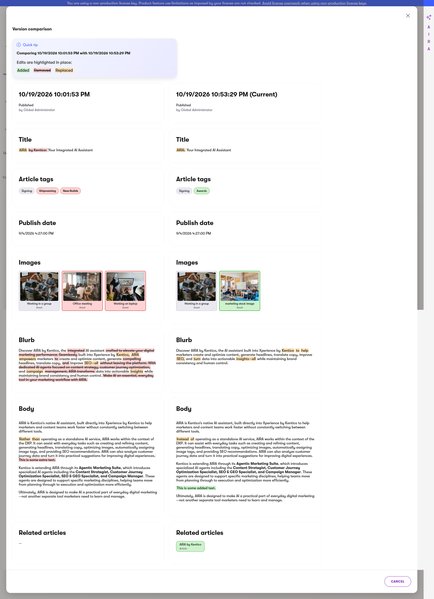

# Xperience by Kentico: Content Item Version Compare

[](https://github.com/Kentico/.github/blob/main/SUPPORT.md#labs-limited-support) [](https://github.com/jakekula/xperience-by-kentico-community-content-item-version-compare/actions/workflows/ci.yml)

## Description

Xperience by Kentico keeps a version history for content items and can restore from it, but it
cannot show what actually changed between two versions. This library adds that: a **Compare
versions** entry in a content item's action menu that shows any two versions side by side, with the
changes highlighted in place.



- Compares any two versions, one row per field, with **added** text green, **removed** text red and
  struck through, and **replaced** text orange
- Includes unpublished work: the current draft can be compared against what is published
- Renders rich text properly, with images, alignment and floats intact, and outlines an image that
  was added, removed or replaced
- Resolves taxonomy terms and linked items to names and thumbnails rather than raw identifiers

Built on Xperience's own admin UI templates. No client module and no JavaScript build step.

Known limitations: only the default content language is compared, assets are not versioned by
Xperience so thumbnails show the current file, and rich text is rendered unsanitised. See the
[Usage Guide](./docs/Usage-Guide.md) for the full list.

## Requirements

### Library Version Matrix

| Xperience Version | Library Version |
| ----------------- | --------------- |
| >= 31.9.3         | 1.0.0           |

### Dependencies

- [ASP.NET Core 8.0](https://dotnet.microsoft.com/en-us/download)
- [Xperience by Kentico](https://docs.kentico.com)

### Other requirements

**Content versioning must be enabled**, or there is nothing to compare. In the administration go to
**Settings → Content → Content versioning**, tick *Enable content versioning* and set a number of
stored versions. Only versions published *after* enabling it are recorded.

## Package Installation

Add the package to your application using the .NET CLI

```powershell
dotnet add package Kentico.Xperience.ContentItemVersionCompare
```

## Quick Start

1. Install the package in the web project of your Xperience solution. The admin pages register
   themselves through assembly attributes, so no start-up code is required.
1. Enable content versioning if it is not already on (see above).
1. Open a content item in the **Content hub** that has at least two stored versions, open the
   dropdown beside the main action button, and choose **Compare versions**.

## Full Instructions

View the [Usage Guide](./docs/Usage-Guide.md) for configuration, customisation and the full list of
limitations.

## Contributing

To see the guidelines for Contributing to Kentico open source software, please see [Kentico's `CONTRIBUTING.md`](https://github.com/Kentico/.github/blob/main/CONTRIBUTING.md) for more information and follow the [Kentico's `CODE_OF_CONDUCT`](https://github.com/Kentico/.github/blob/main/CODE_OF_CONDUCT.md).

Instructions and technical details for contributing to **this** project can be found in [Contributing Setup](./docs/Contributing-Setup.md).

## License

Distributed under the MIT License. See [`LICENSE.md`](./LICENSE.md) for more information.
